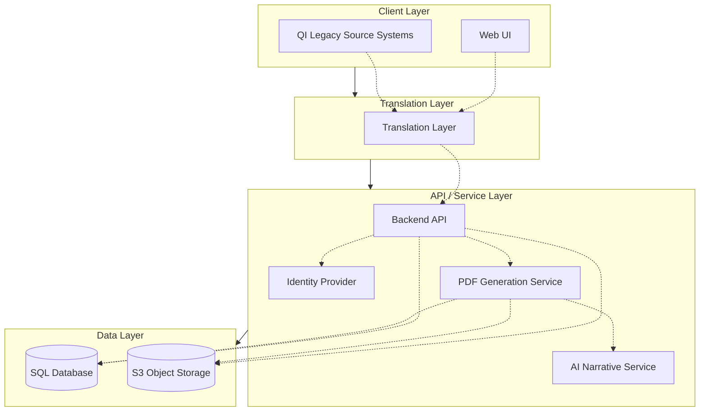
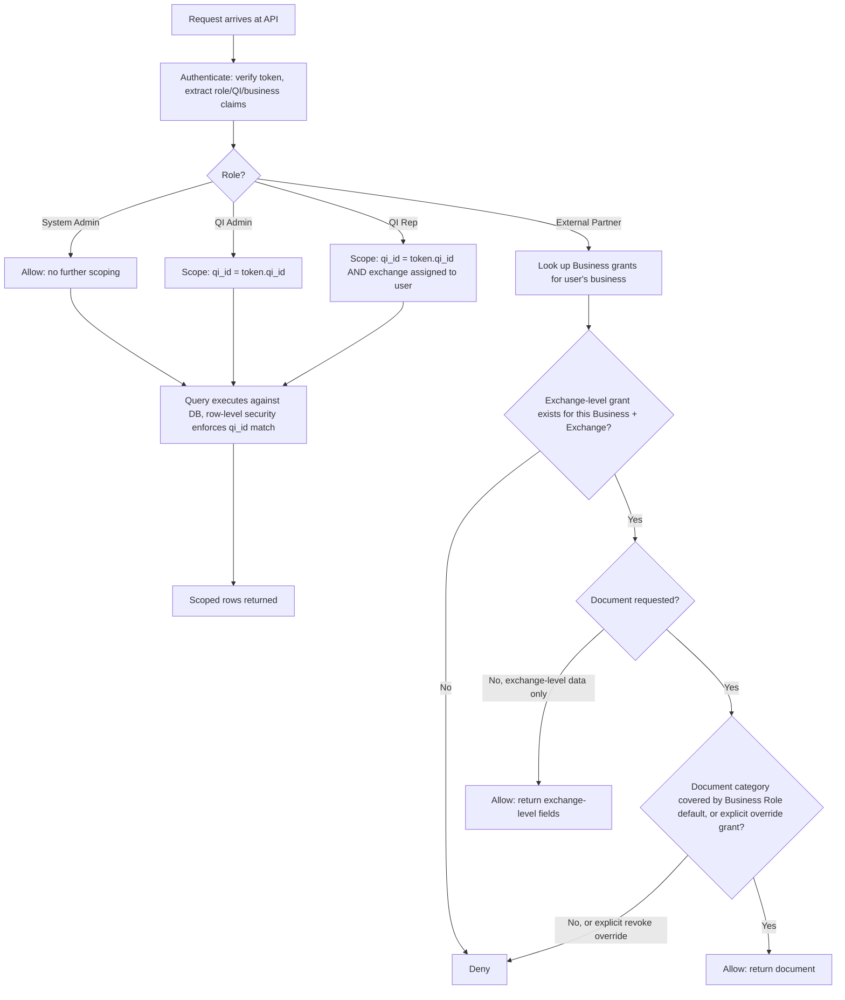
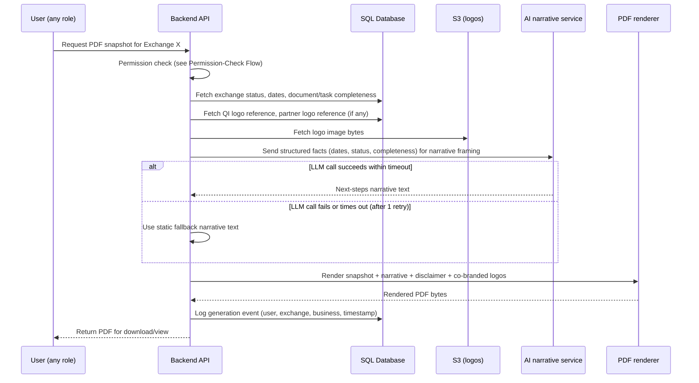

# QI & Partner Data Platform — Design Document

**Status:** Draft for review **Author:** alshap **Last updated:** November 11, 2026

This document has two parts. Part 1 is a business narrative for stakeholders: the problem, the solution, and how we will measure success. Part 2 is the technical design: architecture, data model, and system behavior that implement Part 1. Part 2 includes a High-Level Design (HLD), finalized in this draft, and a Low-Level Design (LLD) section that is partially seeded and will be completed in follow-up iterations.

***

# Part 1: Business Narrative

## Executive Summary

Qualified Intermediaries (QIs) and their external partners — attorneys, title companies, lenders, and other professionals who support 1031 exchanges — currently have no self-service way to check the status of an exchange. Every status check, document request, or deadline reminder requires a phone call or email to one of our customer representatives. Data about exchanges, properties, documents, and funds is scattered across multiple internal systems with no unified view.

We will build a web platform that gives QIs' own staff and their external partners direct, permissioned access to exchange data, backed by a single source of truth data storage layer. Partners see only what they are authorized to see, down to the individual document. The platform includes a self-service PDF snapshot of any exchange's status, with an AI-assisted "next steps" summary, so partners get an answer without placing a call.

The system is designed to grow with the business: onboarding a new QI, adding a new partner role, or changing a permission rule should be small, bounded changes — configuration in most cases, or a simple, isolated code change where needed — never a major engineering effort or a re-architecture.

## Problem Statement

1. **Fragmented data.** Exchange, property, funds, and document data lives in multiple systems with no common access layer. There is no single place to see the state of an exchange.
2. **No self-service access.** External partners (attorneys, title companies, lenders) cannot look up the status of an exchange themselves. Every request goes through a customer representative, by phone or email.
3. **Rep time spent on repetitive lookups.** Customer representatives spend time fulfilling status requests that partners could answer themselves if given the right access.
4. **No fine-grained access control.** Partners work across multiple QIs and multiple exchanges, and their visibility needs vary down to the individual document (e.g., an attorney of record should see a closing document but not an unrelated internal memo). No existing system supports this granularity without manual, per-case administration.
5. **Onboarding new QIs is costly.** Each QI may run its own legacy system with its own schema. Bringing a new QI's historical data into a shared platform today would require custom, one-off engineering work per QI.

## Business Solution

We will deliver a web application, backed by a SQL database and S3 object storage, that:

- Gives **QI staff** (QI Admins and QI Reps) and **external partners** (attorneys, title companies, lenders, etc.) authenticated, role-appropriate access to exchange data without calling a representative.
- Enforces **permission by role and document**, not just by company, so a partner sees exactly the exchanges and documents they are authorized for — and new exchanges automatically extend the right access to the right partners, without manual re-grants per case.
- Provides a **translation layer** so a new QI's legacy data can be loaded into our canonical model through configuration or a small, well-defined code change per QI, not a major integration project, shortening onboarding time for each new QI.
- Generates a **self-service PDF snapshot** of any exchange's status, on demand, with an AI-assisted "next steps" narrative and clear informational-only disclaimers, co-branded with the QI's and partner's logos.
- Is built so that **future growth — new QI onboarding, new partner roles, new permission rules — is a small, bounded change**, not a re-architecture: configuration where possible, a simple isolated code change where not.

Items intentionally **out of scope** for this phase, noted for future extension:

- Data intake/entry into the platform (we assume exchange data already exists in our systems; this project covers display and access, not the systems of record that create the data).
- Two-way sync between our platform and a QI's legacy system (the translation layer is read/batch-oriented now; the architecture keeps a write-path open for later).
- Ingesting external partner companies' own systems' data (only our own QI/exchange data is in scope; a note is included in Part 2 on how this could be added later).
- Email/notification delivery of the PDF snapshot (snapshot generation is in scope; sending it is a future capability).
- CSAT survey collection in the UI (noted as a future capability alongside notifications).

## Key Business Metrics

Because there is no prior system to benchmark against, these are **target outcome metrics** for the new platform, to be tracked from launch:

**Self-service adoption / rep load**

- Share of partner status requests resolved via self-service (web UI or generated PDF) rather than a call or email to a representative. Target: majority self-service within \[TBD] months of launch.
- Reduction in customer representative hours per week spent on manual partner status lookups.

**Partner engagement and referral**

- PDF snapshots generated per partner business per month, as a leading indicator of platform adoption.
- Exchange volume originated by a partner business, tracked alongside that partner's platform usage, as a proxy signal that self-service visibility correlates with more business referred to us. We will track this as a correlation, not claim causation, without a controlled comparison.
- Count and growth of active partner businesses using the platform over time.

**Customer satisfaction**

- Partner CSAT specifically on "staying informed about deal status" (collection mechanism is a future capability — see Part 2).
- Reduction in inbound status-check calls/emails per exchange, as a proxy for satisfaction with self-service.

**Operational**

- Time to onboard a new QI's historical data (target: a configuration change plus data load, not a custom engineering project per QI).

Supporting this requires one architectural commitment: every PDF-generation event must be logged (who, which exchange, which business, when) even though the PDF file itself is not retained — see Part 2, Telemetry.

***

# Part 2: Technical Design (HLD / LLD)

## Technical Executive Summary

The platform is a single web application backed by one SQL database (system of record for structured entities and permissions) and S3 (document and generated-artifact storage). A single identity provider issues credentials and role/scope claims for all four user roles. Access control is enforced server-side at the API layer using role, QI-tenancy, and per-document grants. A configuration-driven translation layer, extended by a small, well-defined adapter interface when a QI's source data needs it, loads each QI's legacy data into a canonical schema without touching the core platform. A PDF generation service composes exchange data, an AI-assisted next-steps narrative, and QI/partner co-branding into an on-demand snapshot document. The design prioritizes extending the system via configuration or small, isolated code changes, not major engineering efforts, as the business adds QIs, roles, and rules.

### Component Diagram

The architecture is organized into four layers, drawn here as stacked horizontal bands so the tiers read top-to-bottom. Every path flows through them in strict order: Client → Translation → Service → Data. The **Client Layer** holds the Web UI (the single application serving all four roles, see User Roles) and the QI Legacy Source Systems (the external systems a QI's historical data is loaded from). The **Translation Layer** sits between the Client Layer and the Service Layer for every request, mapping both live UI traffic and QI legacy data into the canonical schema the Service Layer expects (see Translation Layer). The **API / Service Layer** holds the Backend API (the single entry point into the Data Layer), the Identity Provider (authentication and claims, see Authentication), the PDF Generation Service, and the AI Narrative Service it calls for the next-steps narrative (see PDF Snapshot Generation). The **Data Layer** holds the SQL Database and S3 Object Storage; only the Service Layer reads or writes it directly — the Translation Layer and Client Layer never touch it. This component breakdown is the basis for the Permission-Check Flow and PDF Generation Sequence diagrams later in this document.

## Strategic Context

Today, every QI's data is siloed, and the only channel for an external partner to get an update is a customer representative. This does not scale: as the business adds QIs and partners, representative load grows linearly with status requests. It also limits value to partners, who have no visibility into deal progress unless they ask for it.

The platform must satisfy two requirements in tension: (1) permissions need to be precise, down to the individual document, because partners should never see data outside their authorized scope; and (2) maintaining those permissions must not become a manual, per-exchange chore, or the system will not scale past a handful of QIs and partners. Section "Permission Model" below addresses this directly.

**Design principle: extend by configuration or small, isolated code changes, not major engineering efforts.** Every part of this system that will change as the business grows — onboarding a new QI, adding a partner role, changing a document-visibility rule, adding an entity attribute — is designed to be a data/configuration change wherever possible, or a small, bounded, well-isolated code change (e.g., implementing a defined adapter interface) when some custom logic is unavoidable. The bar is a predictable, contained change, not "zero code." This is called out specifically in the Translation Layer, Permission Model, and Data Model sections below, and is a standing evaluation criterion for any future addition to this system.

## Scale & Non-Functional Requirements

Current state: one QI, running \~500 exchanges/year. Since an exchange runs up to 180 days, roughly 500 × (180/365) ≈ 250 exchanges are active at any given time. The QI has 4 internal employees (QI Admin + QI Reps) and up to several hundred external partner users (attorneys, title officers, CPAs) across its exchanges.

Long-term vision: expansion to a second QI within about a year, and in the magnitude of hundreds of QIs over the long term. These NFRs are sized against that ceiling, not just current volume.

| Dimension                     | Today (1 QI)                                                      | Long-term (up to \~hundreds of QIs)                                                                                                                 | Implication                                                                                                                                                                                                                                                                                                                                   |
| ----------------------------- | ----------------------------------------------------------------- | --------------------------------------------------------------------------------------------------------------------------------------------------- | --------------------------------------------------------------------------------------------------------------------------------------------------------------------------------------------------------------------------------------------------------------------------------------------------------------------------------------------- |
| Active exchanges (concurrent) | \~250                                                             | Tens of thousands, assuming similar volume per QI                                                                                                   | A single SQL database with proper indexing on `qi_id` and assignment columns remains sufficient; read replicas are a lever to add later, not a day-one requirement.                                                                                                                                                                           |
| Exchanges/year                | 500                                                               | Up to \~100,000+                                                                                                                                    | Same as above.                                                                                                                                                                                                                                                                                                                                |
| Internal users                | 4                                                                 | High hundreds (4 × hundreds of QIs)                                                                                                                 | Negligible load driver.                                                                                                                                                                                                                                                                                                                       |
| External partner users        | Up to several hundred (shared across QIs since partners span QIs) | Likely low thousands of unique partners, not a linear multiple of QI count, since the same attorney/title company/CPA often works with multiple QIs | Partner grant lookups should be indexed by business/user, not QI, since a partner's grants can span QIs.                                                                                                                                                                                                                                      |
| PDF generations/day           | \~500 (2/day × \~250 active exchanges)                            | Potentially tens of thousands/day                                                                                                                   | Synchronous LLM calls are acceptable at today's and near-term volume. This is the clearest scaling trigger: if daily generation volume grows an order of magnitude, move to an async/queued generation pattern (request PDF → job queued → notify/poll for completion) to avoid tying up API capacity on LLM latency. Not required at launch. |
| Documents/exchange            | 10–100 (typically \~30–50)                                        | Same ratio, scaling with exchange count                                                                                                             | \~15,000–25,000 new documents/year today, growing toward the low millions long-term. Unremarkable for S3; no special sizing needed now.                                                                                                                                                                                                       |
| Permission-check path         | Per-request indexed DB lookup                                     | Same, until read volume outpaces DB capacity                                                                                                        | No caching layer required at launch. A short-TTL cache of a user's resolved grant set is the lever to add if/when the permission-check path becomes a bottleneck — not built now, to avoid premature complexity and cache-invalidation risk on grant changes.                                                                                 |

These numbers directly inform the multi-tenancy decision in Data Storage below: no tier of this growth curve justifies per-QI databases or schemas.

## User Roles

| Role                  | Scope                                                                      | Notes                                                                                    |
| --------------------- | -------------------------------------------------------------------------- | ---------------------------------------------------------------------------------------- |
| System Admin          | All QIs, all exchanges                                                     | Internal. Full visibility and administrative capability.                                 |
| QI Admin              | One QI, all of that QI's exchanges                                         | Internal. Manages QI Rep users and reviews/manages external partner grants for their QI. |
| QI Rep                | One QI, only exchanges personally assigned to them                         | Internal. Standard caseload-based access.                                                |
| External Partner user | Exchanges/documents their business is granted, which may span multiple QIs | External. Attorneys, title companies, lenders, and similar.                              |

All four roles authenticate through the same identity provider (see Authentication) and use the same web application with role-appropriate views (see Web UI).

## Core Domain Model

| Entity                         | Description                                                                                                                                                                     |
| ------------------------------ | ------------------------------------------------------------------------------------------------------------------------------------------------------------------------------- |
| QI (Qualified Intermediary)    | Tenant that owns a set of Exchanges. Has QI Admin(s) and QI Rep(s).                                                                                                             |
| Exchange                       | A single 1031 exchange. Tracks start date, close date, 45-day identification deadline, and 180-day exchange deadline. Belongs to one QI.                                        |
| Exchanger                      | The taxpayer/client conducting the exchange.                                                                                                                                    |
| Relinquished Property          | The property being sold/given up as part of the exchange.                                                                                                                       |
| Replacement Property           | The property being acquired. An exchange may have more than one.                                                                                                                |
| Funds/Transaction              | Escrow and funds-movement records associated with an exchange.                                                                                                                  |
| Document                       | A file (e.g., closing document, title record) associated with an exchange. Carries the finest grain of access control.                                                          |
| Business                       | An external partner organization (law firm, title company, lender, etc.). Has one or more external partner users. Can be associated with exchanges across multiple QIs.         |
| Business Role (on an Exchange) | The capacity in which a Business participates in a given Exchange (e.g., Attorney of Record, Title Company, Lender). Drives default document visibility — see Permission Model. |

Entities needing variable/evolving attributes (e.g., property sub-types, exchange sub-types that may be added later) should support schema-light extension (e.g., an attributes/metadata column) rather than requiring a migration for every new field — detailed in the LLD data model.

## Authentication

A single identity provider issues credentials for all four roles (default: AWS Cognito user pool, or equivalent). Each user's token carries claims for role, QI affiliation (for QI Admin/QI Rep), and business affiliation (for External Partner users). This avoids maintaining federation with external SSO systems per QI or per partner company, which was an explicit requirement to keep authentication simple to maintain.

MFA and password policy are enforced centrally by the identity provider rather than per-integration. QI Rep's exchange-level assignment (which exchanges they personally see) is enforced at the authorization layer using the assignment data in the SQL database, not encoded in the token, so assignment changes take effect immediately without reissuing credentials.

**Open item carried to LLD:** exact schema structure, token refresh/assignment-change handling, and session management for External Partner users whose business grants change over time.

## Permission Model

Permissions are enforced at two levels: Exchange-level visibility and Document-level visibility. The explicit design goal is that adding a new Exchange should **not** require manually re-granting access to partners who already work with that QI or that Exchanger in a known capacity — see below.

**Internal roles:** enforced by role and QI tenancy (System Admin: all; QI Admin: all exchanges in their QI; QI Rep: only exchanges assigned to them in their QI), per the roles table above.

**External partner roles — the maintainability problem.** A naive design grants partner access per Exchange, one at a time, which does not scale: every new exchange would need someone to manually re-grant the attorney, title company, etc. Instead, we propose a two-layer model:

1. **Role-based default grants.** A Business is pre-authorized for one or more **Business Role** types (e.g., "Acme Title Co. acts as Title Company"). When an Exchange assigns that Business to that role on the exchange, exchange-level visibility and a default set of document-category visibility (e.g., "Title Company role sees documents tagged 'title'") are granted automatically, with no separate manual step. This means onboarding a new exchange for an already-known partner relationship requires no new permission administration.
2. **Manual override layer.** Per-document grants or revocations remain available as an exception mechanism on top of the default (e.g., "this attorney should see Document 1 but not Document 2 on this exchange," even though their role would normally default to seeing both or neither). Overrides are the exception path, not the primary workflow, and should be auditable and reviewable by a QI Admin.

This rule set (role × document-category defaults) is config/data-driven, so adding a new Business Role type or a new document category is a data change, not a code change, consistent with the extensibility principle.

**Status:** this two-layer direction is proposed, not finalized. It needs to be detailed further in the LLD, including: the exact schema for role-to-category default rules, how overrides are recorded and audited, whether a document grant can exist independent of an exchange-level grant, and the QI Admin review/management workflow for partner grants.

### Permission-Check Flow

This makes explicit what the Permission Model describes in prose: internal roles are scoped by tenancy and personal assignment enforced at the database layer, while External Partner access is evaluated against explicit grant rows (exchange-level, then document-level) rather than tenancy.

## Translation Layer (QI Onboarding)

Scope for this phase: loading an **already-existing** QI's data into our canonical schema for display. Data intake/entry workflows are out of scope — we assume the data exists in QI source systems today.

The translation layer onboards a new QI as a small, bounded unit of work, not a major integration project. The preferred default path is a declarative mapping configuration (field mappings, transformation rules, source-to-canonical-entity mapping) for straightforward cases, requiring no code at all. Where a QI's source data needs logic that configuration cannot express (e.g., unusual transformations, conditional mapping), the layer exposes a defined adapter interface: a QI-specific implementation is simple, isolated code that plugs into the mapping engine, not a change to the core platform. Either path keeps onboarding effort proportional to the QI's data complexity, consistent with the "small code changes, not major efforts" requirement as the business adds QIs.

This phase's data flow is one-directional (source QI system → our canonical model), run as a batch/periodic load rather than live sync. The mapping engine and adapter interface are architected so a **write-back path** (two-way sync) can be added later without redesigning either — the configuration format and adapter interface should not assume read-only use.

**Noted for future extension, out of scope now:** ingesting external partner businesses' own systems' data related to exchanges we process (e.g., a title company's system pushing data directly). The same config-driven mapping approach is expected to extend to this case.

## Web UI

A single web application serves all four roles with role-based views and data scoping enforced by the backend (the UI must not be the sole enforcement point — all access control is re-checked server-side). Role-specific UI differences (e.g., QI Admin's partner-grant management screens, System Admin's cross-QI views) are additive views on a common application, not separate applications, to keep maintenance low as roles evolve.

Any user able to view an Exchange (all four roles) can trigger PDF snapshot generation for it on demand — see below.

## PDF Snapshot Generation

**Scope:** on-demand only (no scheduled/triggered generation in this phase). No retention requirement for the generated PDF file itself; it is a regenerate-on-demand artifact, not a historical record. Delivery via email is a future capability — this phase covers generation and download/view only.

**Contents:**

- A snapshot of the Exchange's current status (key dates, 45-day/180-day deadline proximity, document/task completeness) sourced directly from our system data.
- An AI-assisted "next steps" narrative framing a game plan based on the exchange's current status, intended to help the reader understand what to do next.
- A prominent, unambiguous disclaimer: this content is informational only and is not tax or legal advice.
- Co-branding: the QI's logo and, if uploaded, the associated external partner's logo.

**AI guardrails (non-negotiable for this feature):**

- The AI model never computes or asserts facts — dates, names, deadlines, amounts come only from our system data, injected into the generation as ground truth. The model's role is limited to framing/narrative generation from facts we provide, not deriving or recalling them.
- Output must always carry the informational-only / not tax-or-legal-advice disclaimer.
- **Failure handling:** if the AI call fails or times out, the system attempts one retry with a short timeout, then fails open to a partial PDF — the factual snapshot section still renders, and the narrative section is replaced with a static fallback message (e.g., "Next-steps summary unavailable — contact your QI representative"). Generation never blocks or fails outright solely because the AI call failed; the deterministic, system-sourced content is always more important to deliver than the AI narrative.
- **Noted for LLD, explicitly out of scope now:** feeding the exchange's actual documents into the LLM for richer next-steps context. This is a natural extension but introduces data-exposure considerations that need their own review.

**Telemetry requirement:** because the PDF itself is not retained, the generation _event_ (who generated it, for which exchange and business, when) must be logged and retained independently, to support the partner engagement/referral metrics in Part 1.

**Carried to LLD (explicitly deferred by design discussion):**

- Cobranding compositing mechanics: logo upload/storage path, placement/template logic, handling when only one party has a logo or neither does.
- PDF rendering approach/service.
- Exact prompt construction and guardrail enforcement mechanism (e.g., structured data injection vs. free-form prompt, validation of model output against source facts before rendering).

### PDF Generation Sequence

## Data Storage

- **SQL database**: system of record for QIs, Exchanges, Exchangers, Properties, Funds/Transactions, Business/Business Role/permission grant data, and metadata about Documents (not file bytes).
- **S3**: object storage for Document file bytes, uploaded partner/QI logos, and transient generated PDF files (not retained long-term per the no-retention decision above).
- Schema extensibility (new entity attributes, new document categories, new Business Role types) is handled as data/configuration changes, consistent with the extensibility principle — detailed further in the LLD data model.

## Multi-Tenancy & Data Isolation

QI-owned entities (Exchange, Exchanger, Property, Funds/Transaction, Document metadata) are stored in shared tables carrying a `qi_id` column, not in per-QI schemas or separate databases. Isolation between QIs is enforced at the database layer via row-level security (RLS) policies keyed on `qi_id`, not only by application-layer query filtering so a bug in one code path cannot leak another QI's data by omitting a filter. The application layer sets the tenant context per request (from the authenticated user's claims) that the RLS policy checks against.

External Partner access is deliberately modeled differently: since a Business and its users can be granted access across multiple QIs, partner visibility is not a `qi_id`-scoped RLS rule but a set of explicit grant rows (Business ↔ Exchange, and Business ↔ Document) evaluated by the permission-check path above. A partner's effective scope is "the union of exchanges I hold a grant for," not "my QI."

This design is sized against the Scale & NFRs above: at a ceiling of "hundreds of QIs," shared tables plus RLS comfortably handle the data and query volume. Per-QI schemas or databases were considered and rejected (see Alternatives Considered) because they would turn "onboard a new QI" into a schema/database provisioning step, working against the extensibility principle, and would complicate the cross-QI queries External Partner access inherently requires.

**Carried to LLD:** exact RLS policy definitions per table, how tenant context is set and verified per request, and a testing strategy to prove isolation (e.g., automated cross-tenant access attempts in CI).

## Cost Considerations

No real unit-cost figures are available yet; this section is qualitative, to be revisited once usage data and vendor pricing are in hand.

- **S3 storage.** Grows with document volume (an estimated 15,000–25,000 new documents/year for the current QI, scaling toward the low millions long-term) plus uploaded logos and transient PDFs. Transient PDFs are not retained, which caps that contribution; document storage is the long-run cost driver and grows roughly linearly with exchange volume.
- **LLM calls for PDF narrative generation.** Cost scales directly with generation volume: \~500/day today, potentially tens of thousands/day long-term. This is the cost line most sensitive to the business's growth and to the self-service PDF feature's own success, worth monitoring as a unit-economics question once real usage data exists, not a reason to limit usage now.
- **SQL compute.** Row-level security adds a modest per-query overhead versus unfiltered queries. At the sizing in the NFR table this is not expected to be material, but should be confirmed with load testing before the second QI onboards.
- **Translation layer runs.** Batch/periodic loads happen only at QI onboarding, not continuously, so compute cost here is bounded and small relative to steady-state serving costs.

**Carried to LLD:** real unit costs once available, and a concrete point at which LLM cost per generation should trigger a design change (e.g., caching narratives for near-identical states, or a cheaper model tier).

## Security & Threat Model

The riskiest trust boundary in this system is External Partner access: partners are not our employees, their accounts span multiple QIs, and a mistake here directly exposes one QI's or one Exchanger's confidential data to an unauthorized party. This threat model is organized around that boundary.

1. **Cross-tenant data leakage via the permission-check path.** A bug or missing filter in application code exposes another QI's or another partner's data. Mitigated by enforcing tenant isolation at the database layer (RLS, see Multi-Tenancy above), so an application bug's failure mode is a denied query, not a leaked one, plus automated cross-tenant access tests in CI (carried to LLD).
2. **External partner credential compromise.** A partner's account credentials are phished or reused from a breach elsewhere. Mitigated by centrally enforced MFA and password policy at the identity provider (see Authentication), and by scoping the blast radius of a compromised partner account to only that business's granted exchanges/documents, never QI-wide or platform-wide access.
3. **Abuse of self-service access to enumerate or scrape data.** A partner user (or compromised account) calls the PDF generation endpoint or list/detail APIs at high volume to exfiltrate data beyond normal usage. Mitigated by:

   - **Rate limiting** PDF generation per user and per business (specific thresholds carried to LLD, informed by the \~2/day/exchange baseline in the NFR table — a user generating far more than their granted exchange count would justify is the signal to watch for).
   - **Anomaly monitoring** on access patterns: alert when a partner user's request volume or distinct-exchange-access count deviates sharply from their historical pattern or from their granted-exchange count.
4. **Permission misconfiguration granting excess access.** The role-based default grant mechanism (see Permission Model) automatically extends access as exchanges are created which is also its risk: a Business Role mapped to too broad a document-category default over-shares. Mitigated by QI Admin review/audit visibility into current grants and by treating a persistently high manual-override rate (see Success Metrics) as a signal that a default rule is miscalibrated.
5. **Insider risk from internal roles.** A QI Rep or QI Admin account is compromised or misused. Mitigated by the same per-request authorization checks applied to internal roles (QI Rep's personal-assignment scoping is enforced server-side, not just hidden in the UI) and by audit logging of access (see Operational Considerations).

**Carried to LLD:** specific rate-limit thresholds, the anomaly-detection rule set and alerting destination, and confirmation of applicable compliance regimes.

## Operational Considerations

- All access decisions are enforced server-side; the database and S3 are never directly exposed to clients.
- PII and financial data (exchanger identity, funds/transaction records) require encryption at rest and in transit, consistent with the threat model in Security & Threat Model above, pending confirmation of specific compliance regimes (e.g., SOC 2) applicable to this system. \[TBD: confirm specific compliance requirements.]
- Audit logging should cover: permission grants/overrides (who granted/revoked what, when), PDF generation events, and QI data loads via the translation layer.

## Implementation & Rollout Plan

The rollout is staged around the fact that there is currently one QI, with a second expected in about a year.

1. **Phase 0 — Data load and validation.** Load the current QI's existing data via the translation layer into the canonical schema. Validate correctness against the legacy system (spot-check exchanges, properties, documents, funds records) before any user-facing access is granted.
2. **Phase 1 — Internal users first.** Onboard the QI's 4 internal employees (QI Admin + QI Reps) onto the new system. Run a shadow period where reps use the new system for lookups while the existing rep-mediated process remains the official channel, to catch data-quality or permission-mapping issues before any partner sees the system.
3. **Phase 2 — External partner onboarding.** See the onboarding-method decision below; this phase opens self-service access to the QI's attorneys, title officers, and CPAs.
4. **Phase 3 — Parallel run.** The rep-mediated process stays available as a fallback while partner self-service ramps up. Track the Part 1 self-service-adoption metric to judge readiness to proceed.
5. **Phase 4 — Cutover.** Once self-service adoption crosses a threshold (\[TBD] — to be set by the team, informed by Phase 3 data), self-service becomes the primary channel for this QI; the rep-mediated process remains available for edge cases rather than being removed outright.
6. **Phase 5 — Second QI onboarding (\~year 1).** Onboard QI #2 using the same playbook (Phases 0–4). This is also the first real-world test of the translation layer's "small, bounded code change" claim against a second, different source schema — worth treating as a checkpoint on that design assumption.

**Rollback safety:** if the translation-layer load surfaces data-quality issues for a QI at Phase 0, that QI's rollout pauses and defers to the rep-mediated process. Partners should never be exposed to self-served data that has not been validated.

### External Partner Onboarding: Options for Team Discussion

How existing and new external partner users get their accounts is an open decision. Three options are presented here for the team to confirm before Phase 2 begins:

**Option A — Bulk provisioning at launch.** Create and invite accounts for all of the QI's current partners before go-live, since we already know who they are.

- Pros: every partner can self-serve from day one; no gap for existing relationships.
- Cons: requires gathering accurate contact information for every partner upfront; bulk invite emails have low open/activation rates; many accounts will sit unused if that partner isn't actively engaged on a deal at launch.

**Option B — Onboard-as-you-go.** When a partner business/user is assigned a Business Role on an exchange for the first time, the system triggers an account-creation invite at that moment, tied to that specific exchange.

- Pros: minimal upfront data-gathering effort; the invite is contextual, which should drive higher activation; onboarding load spreads out naturally rather than spiking at launch.
- Gap: at cutover, the \~250 exchanges already active have partners already attached. A strict reading of Option B only invites a partner the next time a _new_ assignment touches them, which — given 180-day exchange cycles — could leave an already-attached partner without self-service access for months.

**Option C — Hybrid (recommended).** Combine both: a one-time bulk invite for partners already attached to exchanges active at cutover (closing Option B's gap for in-flight deals), plus onboard-as-you-go for every new exchange/assignment from that point forward.

- Preserves the low-maintenance, contextual steady state of Option B without leaving currently active deals without partner self-service for a full exchange cycle.
- **Recommendation:** adopt the hybrid approach. It is presented alongside A and B for the team to confirm or override before Phase 2 begins.

## Alternatives Considered

- **Per-exchange manual partner grants only** (no role-based default layer): rejected as the primary mechanism because it does not scale — every new exchange would require manual permission administration for already-known partner relationships. Retained only as the override/exception mechanism.
- **Per-QI schema or per-QI database** (instead of shared tables with row-level security): rejected given the Scale & NFRs — even at a ceiling of hundreds of QIs, data and query volume do not justify the operational overhead of schema/database-per-tenant, and it would turn QI onboarding into a provisioning step at odds with the extensibility principle. It would also complicate External Partner queries, which inherently cross QI boundaries.
- **Per-QI custom integration code for onboarding, unconstrained** (a full bespoke integration project per QI, with no shared mapping engine or adapter interface): rejected because it directly conflicts with the requirement that future growth be small, bounded changes rather than major engineering efforts. The accepted middle ground is the mapping-engine-plus-adapter-interface approach above: configuration for the common case, simple isolated code for the exceptions, so onboarding time scales with data complexity rather than open-ended engineering effort.
- **Federated SSO per QI/partner company** (instead of a single identity provider): rejected for this phase as unnecessarily complex to maintain, given no stated hard requirement for external SSO; single IdP with claims-based scoping meets the "not complex or tedious to maintain" requirement directly.
- **AI-generated facts in the PDF narrative** (letting the model compute dates/derive status): rejected due to accuracy and liability risk; facts must come only from system data, with AI limited to narrative framing.

## Success Metrics (Technical)

In addition to the business metrics in Part 1, the technical implementation should be evaluated against:

- Time/effort to onboard a new QI (target: configuration authoring, or a small isolated adapter implementation plus data load, not an open-ended engineering project).
- Time/effort to add a new Business Role type or document category (target: a data change, not a deployment).
- Permission-override rate (how often the manual override layer is used relative to role-based defaults) as a signal of whether the default rule set is well-tuned — a persistently high override rate indicates the default rules need revision.

## Out of Scope (Restated)

- Data intake/entry workflows feeding the system of record.
- Two-way sync between our platform and QI legacy systems (architecture keeps this path open).
- External partner company data ingestion (future extension, same config-driven approach expected to apply).
- Email/notification delivery of PDF snapshots.
- CSAT survey collection UI.
- Feeding exchange documents into the LLM for next-steps generation.

## LLD — To Be Detailed (Tracking List)

The following items are acknowledged open design work, to be resolved in follow-up iterations of this document:

1. Permission model schema: role-to-document-category default rule structure, override/audit schema, whether document grants can exist independent of exchange-level grants.
2. Claims structure and session/assignment-change handling for authentication.
3. Translation layer mapping configuration format and the canonical schema it targets.
4. PDF generation service: rendering approach, AI prompt/guardrail enforcement mechanism, cobranding compositing logic.
5. Data model details: schema-light extension mechanism for evolving entity attributes.
6. Compliance requirements confirmation (PII/financial data handling specifics).
7. Exact RLS policy definitions per table and the automated cross-tenant isolation testing strategy.
8. PDF generation rate-limit thresholds and the anomaly-detection rule set/alerting destination.
9. Real unit cost figures (S3, LLM, compute) once usage data and vendor pricing are available, and the threshold at which to revisit synchronous PDF generation or LLM cost optimization.
10. Rollout cutover threshold (the self-service adoption % that ends the parallel-run phase), to be set by the team.

***

_This document will be iterated section by section. Next step: work through the LLD tracking list above, starting with the permission model schema._

